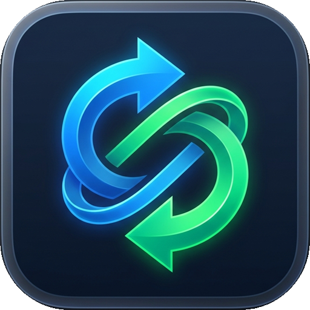

<div align="center">
  

  # Convert to it! — Local Offline Desktop App

  <p>
    A 100% offline-capable local desktop application for <a href="https://p2r3.github.io/convert/">Convert to it!</a> (<code>p2r3/convert</code>) featuring smart Git delta updates and local WebAssembly compilation.
  </p>
</div>

---

## Installation (When Cloned from GitHub)

**Prerequisites:** [Git](https://git-scm.com/) and [Bun](https://bun.sh/) (or portable `.runtime/bun/bun.exe`).

```powershell
git clone https://github.com/akacantr/convert-to-it-local.git
cd convert-to-it-local
bun install
bun run sync   # Clones upstream & builds the initial local offline bundle (app-dist)
bun run start  # Launches the desktop application
```

To optionally create Desktop and Start Menu shortcuts on Windows:
```powershell
powershell -ExecutionPolicy Bypass -File .\create-shortcuts.ps1
```

## How to Launch

1. **Desktop or Start Menu Shortcut:**
   Double-click the **`Convert to it!`** shortcut on your Desktop or Start Menu.
2. **From the Project Folder:**
   Double-click [`Convert-to-it.vbs`](./Convert-to-it.vbs) to launch without a background console window.
3. **From the Terminal:**
   ```powershell
   bun run start
   # or with portable runtime:
   .\.runtime\bun\bun.exe run start
   ```

## Architecture & Features

- **Instant Offline Startup (`app-dist/`):** Launches immediately from the local disk (`app://-/index.html`) without requiring an internet connection. Automatically serves the required `Cross-Origin-Opener-Policy` (`same-origin`) and `Cross-Origin-Embedder-Policy` (`credentialless`) security headers needed for multi-threaded `SharedArrayBuffer` WebAssembly tools (`ffmpeg`, `clang`, `7z`, `imagemagick`, etc.).
- **Smart Git Delta Updates + Local Build ([`src/updater.cjs`](./src/updater.cjs)):**
  - When an internet connection is available, the app silently checks the official `p2r3/convert` GitHub repository in `upstream/`.
  - Instead of re-downloading a 300+ MB bundle whenever converters are updated, it fetches **only the changed source commits** (`git fetch` + `git reset`) and compiles the bundle locally using Bun.
  - Displays live build progress in a sleek bottom-right status bar and offers a **"New Version Ready • Reload"** button once finished.
- **Native Save As Dialog:** Prompts with a native Windows **"Save As"** dialog whenever a converted output file is downloaded, remembering your last chosen directory.
